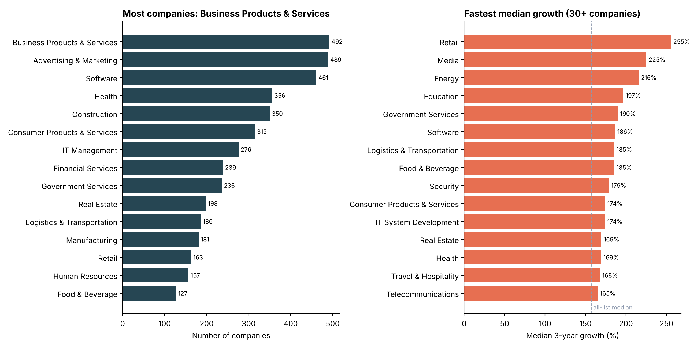
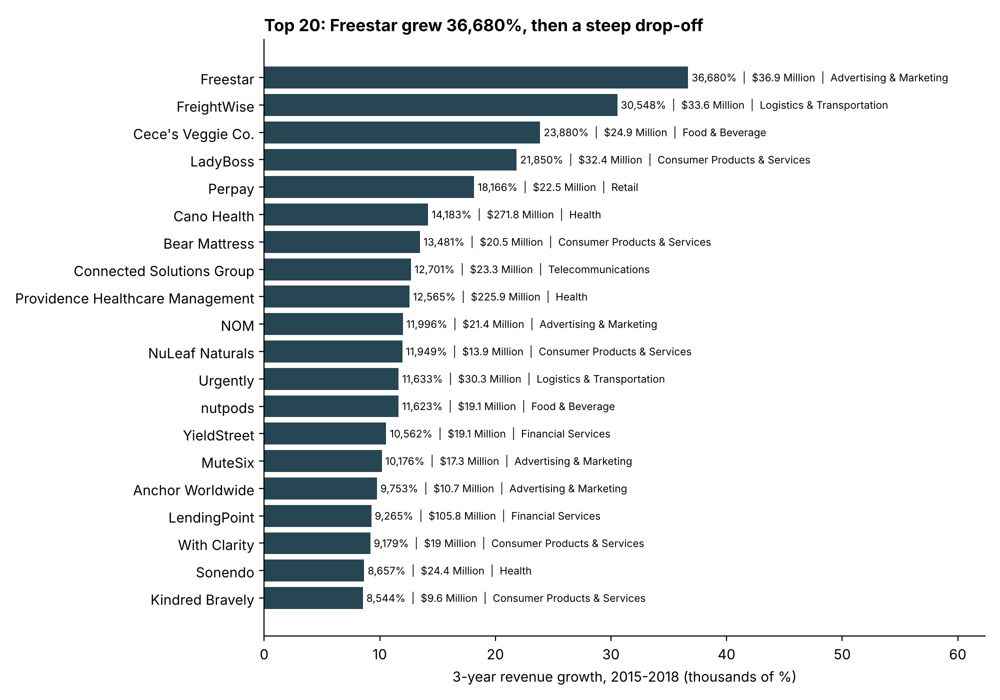
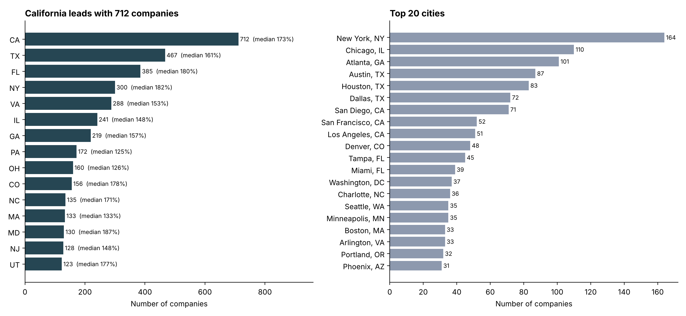
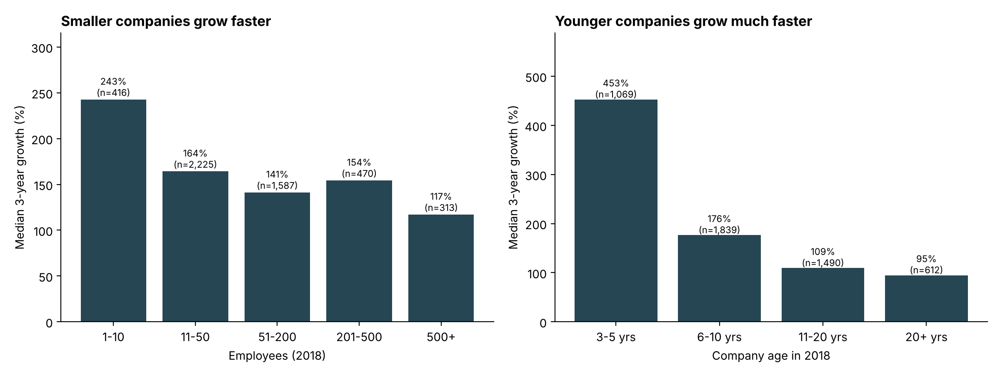
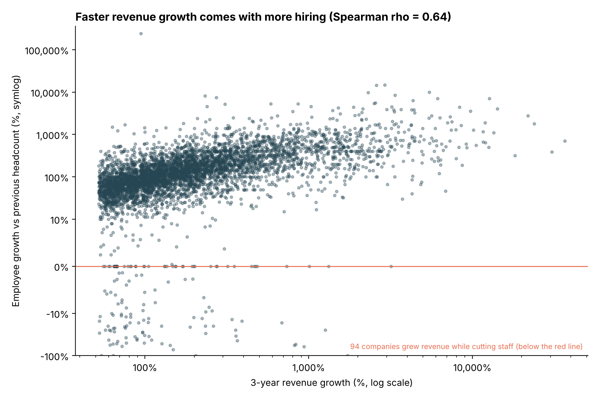

# Inc. 5000 (2019): Where Are America's Fastest-Growing Companies?

A Python and Jupyter analysis of all **5,012 companies** on the 2019 Inc. 5000 list (the fastest-growing private U.S. companies, ranked by revenue growth from 2015 to 2018), with a closer look at the **Top 1,000**.

📓 **[Open the notebook](notebooks/inc5000_2019_analysis.ipynb)**. It runs top to bottom, and GitHub displays it with every chart and table.

🔗 **Companion project:** [Inc. 5000 (2014), Five Years Later](https://github.com/fritzbriones/inc5000-2014-vs-2019-repeat-growers). It tracks which 2014 companies were still on this 2019 list.



## Business question

Which industries, locations, company sizes and company ages produce the fastest growers? Does growth create jobs? Which companies are the strongest targets for outreach or research?

## Key findings

1. **Typical growth was 157.5% over 3 years.** The average (454.7%) is nearly 3× higher because a handful of companies grew by over 10,000%, so this project compares groups by **median**.
2. **Business Products & Services has the most companies (492),** just ahead of Advertising & Marketing (489) and Software (461).
3. **Retail has the fastest typical growth (255%)** among industries with 30+ companies, followed by Media (225%) and Energy (216%).
4. **California leads with 712 companies,** followed by Texas (467) and Florida (385). **New York City** is the top city (164 with a "New York" address; Inc., which counts all five boroughs, reported 199).
5. **Young companies dominate.** Companies 3–5 years old grew a median **453%**, versus **95%** for companies over 20. Smaller companies also grow faster, partly because percentage growth is easier from a small base.
6. **Growth creates jobs.** Revenue growth and hiring go together (Spearman ρ = 0.64). Headcount rose by **656,830** across the list, and only **94** companies cut staff.
7. **The Top 1,000 is a different world.** It took at least **424%** growth to make it, and **58%** of Top-1,000 companies were first-time honorees, versus 32% for the rest of the list.

## Charts






## Data source and verification

The public **"INC 5000 Companies 2019"** dataset from [Maven Analytics' Data Playground](https://mavenanalytics.io/data-playground/inc-5000-companies) and [Kaggle](https://www.kaggle.com/datasets/mysarahmadbhat/inc-5000-companies), compiled from Inc.'s public company profiles. It's stored unchanged in `data/raw/` (SHA-256 `677ae930…5ec8f3`, identical in two independent public copies).

Section 2 of the notebook checks the file against figures Inc. published in August 2019:

| Published by Inc. | This file |
|---|---|
| No. 1: Freestar, 36,680% growth | Freestar, 36,680% ✅ |
| Average growth 454% | 454.7% ✅ |
| Median growth 157% | 157.5% ✅ |
| Aggregate revenue $237.7B | $237.9B ✅ (revenue is rounded to $0.1M per company) |
| 1,216,308 jobs | 1,216,586 ✅ (0.02% difference) |

The file has 5,012 rows rather than 5,000 because some companies tie on rank.

**More checks against 2019 press coverage:**

| Published | This file |
|---|---|
| Inc.'s top 10 (Freestar, FreightWise, Cece's Veggie Co., LadyBoss, Perpay, Cano Health, Bear Mattress, Connected Solutions Group, Providence Healthcare Mgmt, NOM): ranks, growth and revenue | All 10 match ✅ |
| California 712, Texas 468, Florida 384 | 712 ✅, 467, 385 (one company differs between TX and FL) |
| New York State 300 | 300 ✅ |
| Inc.'s top cities: San Francisco 52, Austin 87, San Diego 71, Atlanta 101, Denver 48, Chicago 110, Houston 84, Dallas 74 | All 8 match exactly ✅ |
| New York City 199, Los Angeles 102 | 164 and 51 by mailing city. Inc. includes boroughs and neighborhoods (Brooklyn, Bronx, Venice, Van Nuys…); with NYC's boroughs added, this file gives 193 |

**Data issues handled** (all reported in the notebook):
- 1 founding year of 0 and 1 of 2016 set to missing; a 2016 founding is impossible for 2015–2018 growth.
- 1 missing headcount.
- 813 companies have no metro area; their city and state are kept.

## What's in the repo

```text
data/raw/INC 5000 Companies 2019.csv   original public file (unchanged)
data/inc5000_2019_clean.csv            cleaned data written by the notebook
notebooks/inc5000_2019_analysis.ipynb  the full analysis
images/                                 charts (written by the notebook)
output/top_100_target_companies.csv    fastest 100 companies, for outreach or research
output/industry_summary.csv, state_summary.csv, city_summary.csv
```

## Run it

```bash
pip install -r requirements.txt
jupyter notebook notebooks/inc5000_2019_analysis.ipynb   # then Run All
```

## Limitations

- **Not a random sample.** Companies apply to be listed and must be independent and privately held, with at least $100,000 of revenue in 2015.
- **Percentage growth favors small bases,** so size and age comparisons partly reflect arithmetic.
- **Revenue is rounded** to $0.1M in the source file.
- **City counts use the mailing city,** so New York City and Los Angeles show fewer companies than Inc.'s borough- and neighborhood-inclusive counts.
- **Employee growth** compares 2018 headcount with the file's `previous_workers` figure, whose exact year isn't documented.
- **The findings are associations,** not causes.

## Disclaimer

This is an educational project. All company data, rankings and methodology belong to Inc. This project is not affiliated with, endorsed by or sponsored by Inc. Code is MIT-licensed.
